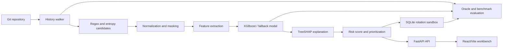
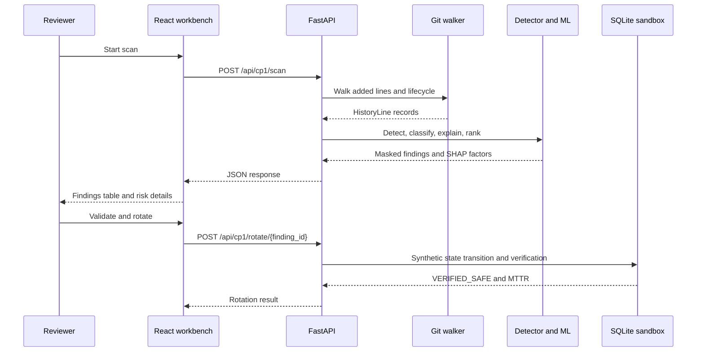

# Detecting and Validating Leaked API Keys in Version Control

Detecting Secrets Across Version Control is a local, research-oriented system
for finding API keys and other credential-shaped values in current files and
Git history. It combines deterministic Git traversal and pattern detection
with entropy/context features, an offline ML filter, TreeSHAP explanations,
risk prioritization, and a SQLite remediation sandbox.

> **Scope:** This repository is a local demonstration and evaluation system.
> It does not authenticate users, call real credential providers, or revoke
> real cloud credentials. The included fixtures use synthetic values.

## Why Git history matters

Deleting a file from the current checkout does not remove its earlier blobs
from reachable commits, branches, tags, or other history surfaces. A scanner
that checks only the working tree can therefore miss credentials that remain
recoverable. This project records lifecycle context such as active-in-HEAD,
deleted-history, branch/tag, and rewritten-history states.

## Objectives and capabilities

- Walk added lines across Git history with GitPython and explicit Git commands.
- Detect provider-shaped patterns and generic high-entropy candidates.
- Normalize findings into masked previews and hashed identifiers.
- Classify candidates with deterministic features and an offline tree model.
- Explain model outputs with TreeSHAP feature contributions.
- Rank findings using model confidence plus lifecycle and privilege context.
- Exercise safe remediation transitions in an in-memory SQLite sandbox.
- Produce reproducible synthetic fixtures, oracle labels, benchmarks, and reports.
- Provide a React/Vite review workbench and FastAPI API for local demonstrations.

## Architecture



The primary API application is
[`src/shd/walker_api.py`](src/shd/walker_api.py), exposed through the
compatibility entry point [`backend/main.py`](backend/main.py). The CP1/O2
pipeline and ML services live under [`backend/`](backend/); the frontend is
under [`frontend/`](frontend/).

## End-to-end workflow



## Technology stack

| Area | Technologies used |
|---|---|
| Languages | Python, TypeScript, JavaScript, YAML, JSON |
| Backend | FastAPI, Uvicorn, Pydantic, SQLAlchemy |
| Frontend | React 18, Vite, React Router, Axios |
| Detection | GitPython, Git CLI, regex, Shannon entropy |
| Machine learning | scikit-learn, XGBoost, NumPy, pandas, joblib |
| Explainability | SHAP / TreeSHAP |
| Storage | SQLite by default; SQLAlchemy supports configured MySQL URLs |
| Reporting | jsPDF, jsPDF-AutoTable, Matplotlib-generated artifacts |
| Testing | pytest, pytest-cov |
| Automation | GitHub Actions, pre-commit, PowerShell helpers |

Only Python dependencies are declared in the root
[`requirements.txt`](requirements.txt). Frontend dependencies and scripts are
declared in [`frontend/package.json`](frontend/package.json). The small root
Node manifest is retained for compatibility with existing project history; run
frontend commands from `frontend/`.

## Repository map

```text
backend/      CP1/O2 services, detection, ML, evaluation, and rotation
data/         Evaluation inputs and frozen split data
docs/         Architecture, setup, evaluation, audit, and contract documents
fixtures/     Ground-truth oracle specification
frontend/     React/Vite review workbench
reports/      Generated baseline metrics and split reports
runtime/      Ignored local SQLite databases
scripts/      Reproduction, evaluation, generation, and health-check tools
src/shd/      FastAPI application, persistence, core walkers, and API models
testdata/     Seeded repository generator and independent fixture
tests/        Unit, integration, and evaluation-oriented tests
artifacts/    Generated evidence, plots, models, benchmark results, and fixture
```

See [`docs/project-structure.md`](docs/project-structure.md) for the detailed
responsibility of every root-level folder.

## Installation

### Prerequisites

- Python 3.11 or newer
- Node.js and npm
- Git
- Optional: Gitleaks on `PATH` for native baseline comparison

### Backend environment

```powershell
python -m venv .venv
.\.venv\Scripts\Activate.ps1
pip install -r requirements.txt
Copy-Item .env.example .env
```

The default database is `runtime/shd-local.sqlite3`. Set `DATABASE_URL` for
another SQLAlchemy-compatible database URL. Never commit `.env` or real
credentials.

### Frontend environment

```powershell
Set-Location frontend
npm install
```

Use `VITE_API_URL` when the backend is not at `http://localhost:8000`.

## Running the application

Start the backend from the repository root:

```powershell
uvicorn backend.main:app --reload --port 8000
```

The API is available at `http://127.0.0.1:8000`; interactive OpenAPI docs are
at `/docs`. The compatibility entry point
`uvicorn src.shd.walker_api:app --reload --port 8000` is also supported.

In a second terminal:

```powershell
Set-Location frontend
npm run dev
```

Open `http://localhost:5173/vaultguard/home`.

Useful API routes include:

- `GET /health`
- `POST /api/cp1/scan`
- `POST /api/cp1/rotate/{finding_id}`
- `GET /api/cp1/overview`
- `POST /api/cp1/benchmark/run`
- `GET /docs`

Compatibility JSON routes `/api/scan` and `/api/rotate` are also available.
See [`docs/api-documentation.md`](docs/api-documentation.md).

## Testing and health checks

Run the Python suite:

```powershell
python -m pytest
```

Build the frontend:

```powershell
Set-Location frontend
npm run build
```

With the backend running, execute the one-click readiness check:

```powershell
python scripts/verify_system_health.py
```

It verifies API/database health, the persisted detector model, and the SQLite
rotation sandbox.

## Evaluation and benchmarking

Generate the synthetic history fixture and oracle:

```powershell
python -c "from backend.services.fixture_generator import generate_fixture; generate_fixture()"
```

Run the O2 benchmark and focused CP1 test:

```powershell
python scripts/reproduce_o2.py
```

Run the earlier evaluation pipeline:

```powershell
python -m backend.ml_filter.train
python -m backend.ml_filter.evaluate
```

The benchmark implementation is
[`backend/services/benchmark_engine.py`](backend/services/benchmark_engine.py).
The oracle specification is
[`fixtures/oracle_spec.yaml`](fixtures/oracle_spec.yaml). Results are written
to `artifacts/` and `reports/`; they are not automatically proof of
real-world provider validity.

## Dataset, model, and explainability

The repository uses synthetic planted values and high-entropy decoys for
repeatable tests. `data/o2_evaluation.json` contains the earlier labeled
evaluation corpus, `data/real_repo_20_labels.csv` supports the frozen
repository-group ML experiment, and `fixtures/oracle_spec.yaml` defines
lifecycle ground truth. See
[`docs/dataset-documentation.md`](docs/dataset-documentation.md).

`backend/ml/detector.py` defines provider patterns, `shannon_entropy()`,
`extract_14_features()`, model loading, and candidate detection.
`backend/ml/xgboost_rigour.py` runs frozen-split XGBoost ablations.
`backend/ml/shap_risk_scorer.py` computes TreeSHAP contributions and ranking
metrics. If the persisted model is missing, the detector builds a deterministic
lightweight model; a corrupt model is logged and rebuilt.

## Evaluation results and definitions

The checked-in O2 benchmark artifact
[`artifacts/o2_benchmark_kpis.json`](artifacts/o2_benchmark_kpis.json) reports
for the recorded **Our O2 Engine** run: precision `1.0`, recall `1.0`, F1
`1.0`, six true positives, zero false positives, and zero false negatives.
These are synthetic-fixture results. The separate held-out 14-feature
XGBoost artifact reports precision `0.75`, recall `1.0`, and F1
`0.8571428571428571`. Do not conflate these evaluation scopes.

- **Precision:** `TP / (TP + FP)`.
- **Recall:** `TP / (TP + FN)`.
- **F1:** harmonic mean of precision and recall.
- **NDCG@10:** top-ten ranking quality weighted toward higher positions.
- **MTTR:** measured local state-machine time from detection acceptance to
  verified safe SQLite state; it is not real provider revocation latency.

Detailed methodology is in
[`docs/evaluation-methodology.md`](docs/evaluation-methodology.md).

## Documentation

- [Project overview](docs/project-overview.md)
- [Architecture](docs/architecture.md)
- [Installation guide](docs/installation-guide.md)
- [Usage guide](docs/usage-guide.md)
- [API documentation](docs/api-documentation.md)
- [Dataset documentation](docs/dataset-documentation.md)
- [Evaluation methodology](docs/evaluation-methodology.md)
- [Project structure](docs/project-structure.md)
- [Existing O1 contract](docs/o1_engineering_contract.md)
- [Existing review/audit records](docs/review_summary.md)

## Security and limitations

- Use synthetic fixtures only; never place real credentials in tests, docs,
  reports, or examples.
- The frontend is a trusted, single-user local deployment with no auth/RBAC.
- Provider validation and real credential revocation are not implemented.
- Gitleaks is optional for the local emulator-backed benchmark but required for
  workflows that explicitly invoke the native binary.
- The evaluation corpus is synthetic/small and must not be presented as a
  production prevalence estimate.
- Generated artifacts may contain masked previews and benchmark metadata; audit
  them before publishing externally.

## Contributing and acknowledgements

See [`CONTRIBUTING.md`](CONTRIBUTING.md) for the development checklist.
The project uses GitPython, FastAPI, SQLAlchemy, React, scikit-learn, XGBoost,
SHAP, pytest, and related open-source packages listed in the manifests.
