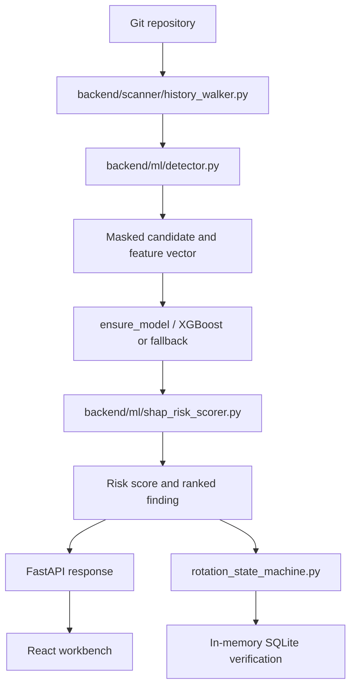

# Architecture

## Pipeline

## Components

| Component | Input | Processing | Output |
|---|---|---|---|
| History walker | Git repository path | Enumerates commits/refs and diffs added lines | `HistoryLine` with lifecycle |
| Pattern detector | Added line | Provider regexes, Base64 checks, candidate extraction | Candidate tokens |
| Feature extraction | Candidate, path, context | Entropy, ratios, keywords, path risk, syntax, length | 14-feature vector |
| Model filter | Feature vector | XGBoost probability and heuristic decoy checks | ML probability/false-positive flag |
| Normalization | Raw detector fields | SHA-256 hash and masked preview | Safe finding boundary |
| TreeSHAP scorer | Model and feature matrix | Feature contributions and composite risk | Explanations and NDCG |
| API/storage | Findings and requests | FastAPI routes and SQLAlchemy persistence | JSON/UI data |
| Rotation sandbox | Finding ID | SQLite state transitions and post-update verification | `VERIFIED_SAFE`, failure state, MTTR |

## Application entry points

- [`backend/main.py`](../backend/main.py) imports the FastAPI app from
  [`src/shd/walker_api.py`](../src/shd/walker_api.py).
- [`backend/pipeline.py`](../backend/pipeline.py) is the earlier repository
  pipeline using Gitleaks normalization and the seven-feature ML filter.
- [`backend/services/benchmark_engine.py`](../backend/services/benchmark_engine.py)
  is the O2 head-to-head benchmark path.
- [`frontend/src/pages/Cp1WorkbenchPage.tsx`](../frontend/src/pages/Cp1WorkbenchPage.tsx)
  is the primary current workbench.

## Data safety

The normalizer hashes the detected value and stores a masked preview. The
history walker masks externally persisted lines. Frontend display helpers mask
values again. Synthetic fixtures intentionally contain credential-shaped test
strings and must remain clearly labeled as synthetic.
