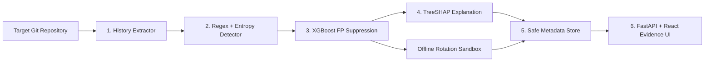

# CP1 Gate 1 — Frozen Engineering Contract

**Version:** 1.0.0  
**Status:** FROZEN  
**Objective:** Validate the Git-history leakage problem and freeze the engineering contract.

The machine-readable contract is [`backend/data/o1_engineering_contract.json`](../backend/data/o1_engineering_contract.json). The O1.1 reproduction is available as [`artifacts/o1_reproduction_log.json`](../artifacts/o1_reproduction_log.json) and is served by the API without plaintext credential material.

## O1.2 Source-to-Claim Map

| ID | Claim | Empirical verification | Status |
|---|---|---|---|
| C1 | Deleting a secret-bearing file does not delete reachable history | O1.1 `git log -p --all` finds the planted marker while HEAD does not | Verified |
| C2 | Credentials must be revoked/rotated, not merely removed | O1.1 reports history-only/recoverable, never revoked | Verified |
| C3 | History, branches, tags, and encoded content are distinct surfaces | O1.6 oracle provides six lifecycle labels | Contract |
| C4 | Detection evidence must be minimized and protected | O1.1 persisted diff is redacted; API/UI expose safe metadata | Verified |
| C5 | Detection requires validation and false-positive controls | O2 corpus includes secret, fixture, documentation, and false-positive labels | Verified |

## O1.3 Requirements

### Functional requirements

| ID | Requirement |
|---|---|
| FR-1 | Traverse reachable commits, branches, tags, and deleted blobs, recording commit, path, line, and lifecycle. |
| FR-2 | Apply bounded provider regexes and Shannon entropy to text blobs, skipping binary data and enforcing resource caps. |
| FR-3 | Use a versioned offline XGBoost classifier after deterministic detection to suppress likely fixtures/examples. |
| FR-4 | Compare findings with HEAD and emit `STILL_IN_HEAD` or historical-only state without inferring revocation. |
| FR-5 | Return bounded TreeSHAP feature contributions and model version without returning matched plaintext. |
| FR-6 | Run authorized synthetic rotation in an isolated offline sandbox and fail closed when unavailable. |
| FR-7 | Compare Gitleaks-only and Gitleaks-plus-ML baselines on the frozen corpus. |

### Non-functional requirements

| ID | Requirement |
|---|---|
| NFR-1 | Mask plaintext in UI, API, logs, artifacts, and reports. |
| NFR-2 | Scan 100 commits in under 5 seconds excluding clone time. |
| NFR-3 | Keep peak resident memory below 512 MB for the benchmark corpus. |
| NFR-4 | Make labels, metrics, and artifact schema deterministic for the same fixture/configuration. |
| NFR-5 | Persist zero plaintext credentials in DB, logs, API/UI state, or reports. |
| NFR-6 | Keep rotation offline, synthetic, bounded, and fail-closed. |

## O1.4 Architecture and ADR

| ADR | Decision | Rationale |
|---|---|---|
| ADR-001 | GitPython plus subprocess evidence commands | Fits the existing Python pipeline; avoids shell interpolation while preserving explicit Git CLI proof. |
| ADR-002 | Regex plus Shannon entropy | Combines explainable provider precision with generic high-entropy coverage. |
| ADR-003 | XGBoost | Efficient deterministic tabular inference for the small offline corpus. |
| ADR-004 | TreeSHAP | Provides feature-level tree-model explanations rather than opaque scores. |
| ADR-005 | FastAPI + SQLAlchemy + MySQL/SQLite | Matches the current typed API/ORM and preserves local SQLite development. |
| ADR-006 | React | Reuses the existing dashboard and jsPDF export path. |

## O1.5 STRIDE threat model

**Trust boundaries:** Untrusted Target Repo ↔ Scanner Worker ↔ ML Engine ↔ MySQL DB ↔ Rotation Sandbox ↔ React UI.

**Assets:** repository history and metadata; safe fingerprints and masked previews; ground-truth labels/evaluation artifacts; model explanations and rotation results.

**Misuse cases:** ReDoS regex bomb, malicious Git hooks, plaintext exfiltration via UI/API/logs, binary/decompression bomb, and resource exhaustion through enormous history.

| STRIDE | Threat | Control |
|---|---|---|
| Spoofing | Untrusted repo impersonates an approved target | Validate path/identity and require explicit scan input |
| Tampering | Hooks or worktree mutate evidence | Disable hooks, use read-only extraction, isolate workers |
| Repudiation | Scan cannot be reproduced | Persist detector/model/config versions and fixture IDs |
| Information disclosure | Plaintext leaks through outputs | Redact at persistence/response boundaries and test outputs |
| Denial of service | Regex/blob/history explosion | Timeouts, byte caps, bounded regexes, memory telemetry |
| Elevation of privilege | Sandbox reaches host/provider | Offline least-privilege container with synthetic credentials |

| Risk | Likelihood | Impact | Mitigation |
|---|---|---|---|
| Plaintext evidence exfiltration | Medium | Critical | Redaction and output-surface tests |
| Malicious Git hook execution | Medium | High | Disable hooks; never execute repository scripts |
| Resource exhaustion | High | High | Timeouts, quotas, binary checks |
| False-positive rotation | Medium | High | ML suppression and human approval |
| History blind spot | Medium | High | Enumerate refs/tags and report limitations |

## O1.7 Acceptance plan

| ID | Pass threshold |
|---|---|
| AC-1 | O1.1 proves history presence and HEAD absence; deletion is never reported as revocation. |
| AC-2 | Repeat runs preserve schema, labels, paths, and verification booleans. |
| AC-3 | Zero planted plaintext matches occur in persisted artifacts, responses, UI state, logs, or PDFs. |
| AC-4 | Metrics identify the frozen corpus, split, detector/model versions, and executed evidence. |

| KPI | Target |
|---|---|
| Historical Recall | ≥ 0.90 |
| Precision / F1 | ≥ 0.80 precision and ≥ 0.80 F1 |
| False Positive Rate | ≤ 0.10 |
| Unsafe Outcome Count | 0 |
| Scan Time / RAM Profile | < 5 seconds / < 512 MB |
| Rotation MTTR | Baseline recorded; no provider call |

### Negative tests

| ID | Case | Expected |
|---|---|---|
| NT-1 | Empty repo | No findings and structured pass/empty result |
| NT-2 | 10MB single-line minified JavaScript | Bounded scan without timeout or unbounded memory |
| NT-3 | Binary file bomb | Safe skip without decoding exception or plaintext output |
| NT-4 | Detached HEAD/orphaned branch | Report refs/lifecycle without assuming HEAD reachability |
| NT-5 | Corrupted encoding | Safe skip/error status while continuing other files |

## Evidence surfaces

- CLI: `python scripts/reproduce_problem.py`
- JSON artifact: `artifacts/o1_reproduction_log.json`
- Markdown artifact: `docs/o1_reproduction_log.md`
- API: `GET /o1/evidence`, `GET /o1/reproduction`, `GET /o1/contract`, `GET /o1/dependencies`
- UI: **O1 Evidence** page with inline masked JSON and PDF export.
